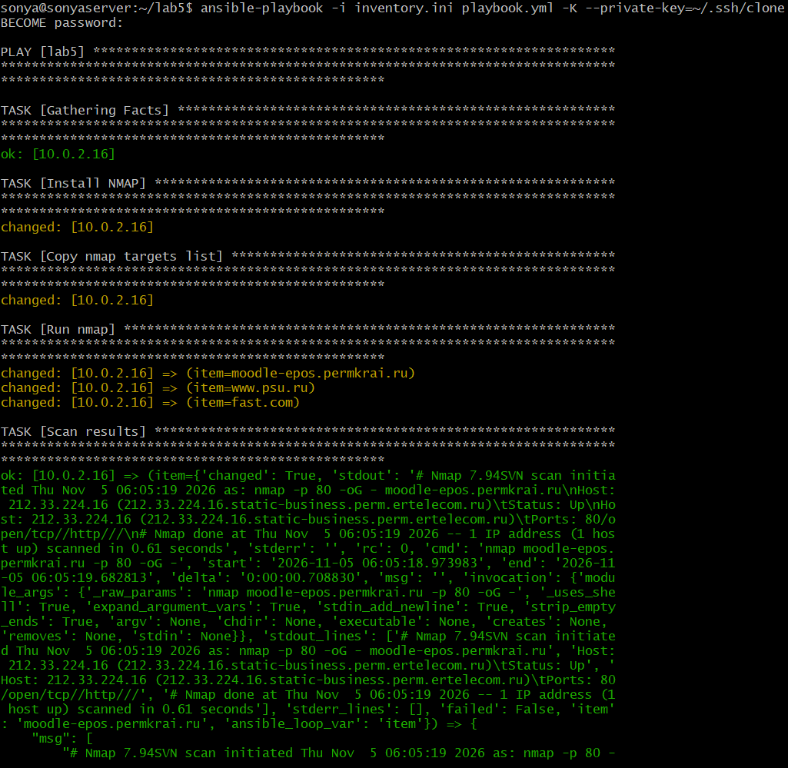
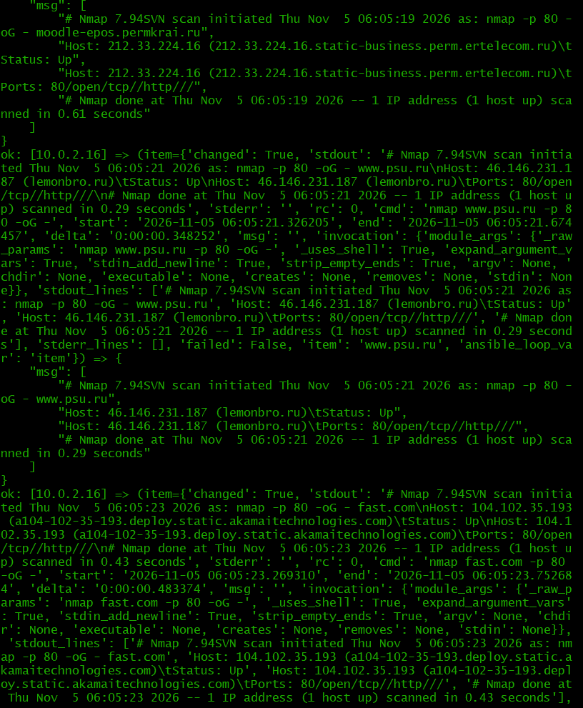
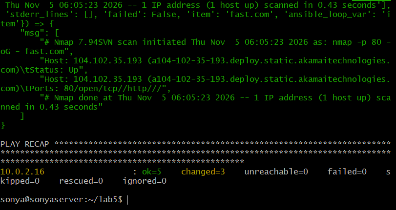

Я студентка ПГНИУ, ИКНТ, 3 курс, группа ИТ-13-2024, Палкина Софья.
Здесь я разместила файлы и результаты работы лабораторной работы №5 по предмету "Devops и администрирование (Методы и инструменты DevOps)".

Логи запуска ansible:

Эти же логи есть в файле log.txt
